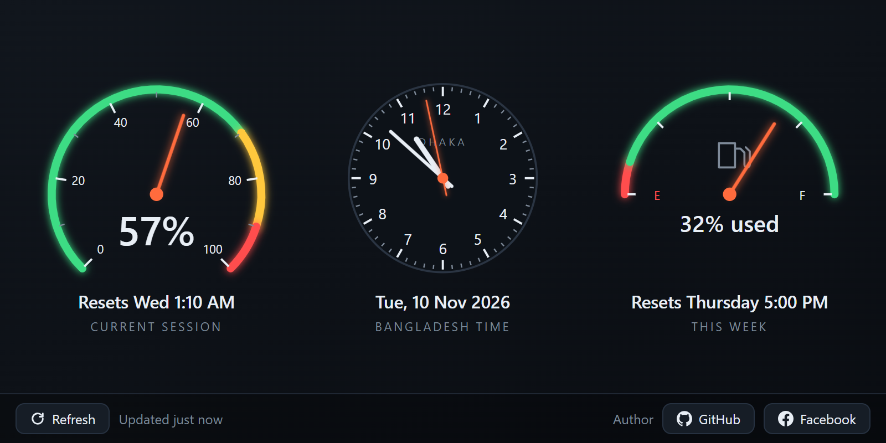

# Claude Usage Meter

A small Windows app that shows how much of your Claude usage limit you have used, as a car-style speedometer and fuel gauge, with an analog clock in Bangladesh time between them.



> **Unofficial.** This project is not made by or connected to Anthropic. It reads the same usage page you can open yourself at [claude.ai/settings/usage](https://claude.ai/settings/usage).

## What you see

| | Shows |
|---|---|
| **Speedometer** (left) | How much of your **current session** limit you have used. Green below 70%, yellow from 70%, red from 90%. The line under it says when the session resets. |
| **Clock** (middle) | **Bangladesh time** (UTC+6), set from internet time servers, with today's date under it. It shows Bangladesh time even if your PC uses another time zone. |
| **Fuel gauge** (right) | Your limit for **this week**. The needle shows what is left (F = full, E = empty) and the number shows how much you have used. It blinks when less than 10% is left. |

The bar at the bottom has a **Refresh** button, the time of the last update, and links to the author.

## Requirements

- Windows 10 or 11, 64-bit
- A Claude account at claude.ai

## Install

1. Download **UsageWidget-Setup.exe** from the [Releases page](https://github.com/ehemon3059/claude-usage-meter/releases).
2. Run it. The installer is not code-signed, so Windows may say **"Windows protected your PC"**. Click **More info**, then **Run anyway**.
3. That's it. It installs for your Windows account only (no admin rights needed), adds **Usage Widget** to the Start menu and the desktop, and opens the app.

The shortcut is called **Usage Widget**. The window title is **Claude Usage Meter**.

## First start: sign in to Claude

The first time you open the app, a claude.ai sign-in window appears. Sign in the way you normally do.

Once you are signed in, the meters fill in, usually within a minute, and the sign-in window usually closes by itself. If it stays open, you can close it.

You type your details on claude.ai's own page. The app does not store your password. It keeps only claude.ai's sign-in cookie, in its own folder on your PC.

## Using it

### The window

- Drag the edges to resize it, or maximize it. The meters grow and shrink to fit, and the app remembers the size and position.
- Clicking **X** does not quit. The app keeps running in the system tray so it can keep checking your usage and send alerts.
- To bring the window back, click the tray icon, or open **Usage Widget** from the Start menu again.

### Refresh

- The app checks your usage every 3 minutes on its own.
- Click **Refresh** to check right now. You can refresh at most once every 30 seconds, so that claude.ai doesn't block the app. If you click sooner, it tells you how many seconds to wait.
- Next to the button you'll see when the numbers were last updated, or one of the messages below.

### Tray icon

The app's icon is an orange ring in the system tray, at the right end of the taskbar. If you don't see it, click the **^** arrow there.

- **Point at it** to see your usage, for example `Session 57% | Week 32%`.
- **Click it** to open the window.
- **Right-click it** for the menu:
  - **Refresh now**
  - **Show/Hide** the window
  - **Re-login**: opens the claude.ai sign-in window
  - **Start with Windows**: tick it to open the app every time you sign in to Windows
  - **Quit**: closes the app completely

### Alerts

You get a Windows notification when your session or your week reaches **80%** and **95%** (once each until it resets), and when a limit resets.

### Messages

| Message | What it means | What to do |
|---|---|---|
| Updated 3 min ago | Everything is working. | Nothing. |
| Please log in | You are signed out of claude.ai. | Sign in, in the window that opens. Or use tray menu → **Re-login**. |
| Verification needed | claude.ai wants to check that you are human. | Finish the check in the window that opens. |
| Offline | The app could not reach claude.ai. | Check your internet. The app tries again by itself. |
| Couldn't read page | The usage page did not load, or claude.ai changed it. | Try **Refresh** later. If it keeps happening, the app may need an update. |
| BD TIME · PC CLOCK (under the clock) | The internet time servers could not be reached. | Nothing. The clock uses your PC's clock and tries again every 2 minutes. |

While a message is shown, the meters keep the last numbers that were read, and the message says how old they are.

## Update to a new version

Quit the app (tray menu → **Quit**), then run the new installer. Your sign-in and settings are kept.

## Uninstall

Open **Settings → Apps → Installed apps**, find **Usage Widget**, and choose **Uninstall**.

Your sign-in and settings stay in `%APPDATA%\usage-widget`. Delete that folder if you want them gone too.

## Privacy

The app only connects to:

- **claude.ai**, to read your usage page with your own sign-in. Those pages behave just as they do in your browser.
- **Time servers** (time.google.com, pool.ntp.org, time.windows.com, or google.com), to set the clock.

It has no account, server, or tracking of its own. Everything it saves stays on your PC in `%APPDATA%\usage-widget`.

## How it works

The app opens [claude.ai/settings/usage](https://claude.ai/settings/usage) in a hidden window, using your sign-in, and reads the text on the page, such as "57% used" and "Resets Wed 1:10 AM". It does not need an API key. If Anthropic changes that page, the app may stop reading it correctly until it is updated.

## Build from source

You need Windows, [Node.js](https://nodejs.org) 22 or newer, and Git.

```bash
git clone https://github.com/ehemon3059/claude-usage-meter.git
cd claude-usage-meter/usage-widget
npm install
npm start           # run the app
npm test            # run the tests
npm run build       # create dist/UsageWidget-Setup.exe
npm run dev:gauges  # preview the meters with sliders (no claude.ai needed)
```

If the installed app is running, `npm start` closes right away without any message: only one copy can run at a time, and both use the same data folder. Quit the installed app from the tray first.

### Project files

All app code is in `usage-widget/`:

| File | What it does |
|---|---|
| `main.js` | Starts the app: the window, the tray, checking every 3 minutes, alerts, and clock sync |
| `scraper.js` | Opens the claude.ai usage page in a hidden window and returns its text |
| `parser.js` | Finds the percentages and reset times in that text |
| `timesync.js` | Gets the time from internet time servers (NTP, with an HTTPS fallback) |
| `gauges.js`, `clock.js` | Draw the speedometer, the fuel gauge, and the clock |
| `widget.html`, `widget.css`, `widget.js` | The window's page and its buttons |
| `preload.js` | The only link between the page and the rest of the app |
| `state.js`, `alerts.js` | Small helpers: window position, refresh limits, and alert rules |
| `tests/` | Unit tests, run with `npm test` |

## Author

Made by **Eh.Emon**: [GitHub](https://github.com/ehemon3059) · [Facebook](https://www.facebook.com/eh.emon3059/)
